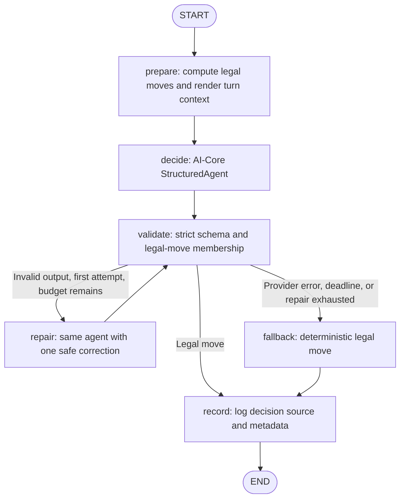

# GenAI Domino Player

A stateless FastAPI player for the Domino Master. It accepts the Master's current hand and public game state on every turn, computes legal moves locally, and uses AI-Core's agents, prompt providers, and LLM providers to choose among them.

A LangGraph `StateGraph` explicitly orchestrates the turn for pedagogical purposes. The Master remains authoritative for accepting moves and ending games.

## Turn orchestration with LangGraph

The graph is compiled once when the application starts, then executed asynchronously with fresh state for every `/play` request. FastAPI validates the request before entering the graph; invalid requests never invoke an agent.



- **AI-Core agent:** `StructuredAgent[MoveResponse]` prepares role-tagged messages and delegates structured generation to the configured `LlmProvider`. Both `decide` and `repair` call this agent, not the provider directly.
- **AI-Core prompt provider:** `StaticPromptProvider` supplies the system prompt loaded from `prompts/domino-system.md`. Its f-string template syntax requires literal braces to be escaped internally; the model receives the exact original text, including JSON examples. The player template still uses only the three specified literal JSON-token replacements, then becomes the agent's user query. This deliberately avoids interpreting game JSON as Jinja2 or f-string templates.
- **Validation and repair:** Python checks the candidate against independently enumerated legal moves. Only malformed/illegal output can enter `repair`, at most once. A repair sends the original user prompt plus an application-generated correction; it does not echo invalid output or carry conversation history from another turn.
- **Shared deadline:** preparation, graph transitions, provider retries, and repair use a single absolute turn deadline. Each generation is cancelled at that same deadline. There are no graph-level retries or extra agent loops. Deadline/provider failures route to `fallback`, then `record`. Keep deployment margin below the Master's timeout for local fallback, logging, and HTTP delivery.
- **Request isolation:** state contains the authoritative request, legal moves, prompt, candidate, attempt/retry counts, deadline, and final move/source. There is no checkpointer, persistent memory, or retained hand. `/end` bypasses the graph and never calls an agent.

## Setup

Requires Python 3.11 or newer. From the repository root:

```powershell
py -m venv .venv
.\.venv\Scripts\Activate.ps1
python -m pip install -r requirements.txt
```

Create a `.env` file in the repository root with the following values, or set them in the process environment before starting the API:

```text
AI_CORE_PROVIDER=openai
AI_CORE_MODEL=<provider model or deployment name>
TURN_TIMEOUT_SECONDS=<positive number below the Master's HTTP timeout>
AI_CORE_TEMPERATURE=0
OPENAI_API_KEY=<secret from the environment or secret manager>
```

Startup automatically loads the repository-root `.env` for both `python -m domino_player` and the Uvicorn ASGI entry point. It does not search the current working directory. Existing process environment variables take precedence over `.env` values. The file is optional when the required variables are already set in the environment. Keep credentials out of Git; `.env` is ignored by this repository.

`TURN_TIMEOUT_SECONDS` is required because the Master's timeout is deployment specific. The AI-Core adapter may retry rate limits, but all attempts and one optional response repair are bounded by this total deadline.

Supported `AI_CORE_PROVIDER` values and their provider-specific configuration:

| Provider | Model setting | Required credential/configuration |
|---|---|---|
| `openai` | `AI_CORE_MODEL` | `OPENAI_API_KEY` |
| `azure-openai` | Azure deployment name | `AZURE_OPENAI_ENDPOINT`, `AZURE_OPENAI_API_KEY`, `AZURE_OPENAI_API_VERSION` |
| `google` | `AI_CORE_MODEL` | `GOOGLE_API_KEY` |
| `bedrock` | Bedrock model ID | AWS SDK credentials and `AWS_REGION` or `AWS_DEFAULT_REGION` |
| `ollama` | `AI_CORE_MODEL` | Optional `OLLAMA_BASE_URL` (default `http://localhost:11434`) |
| `openrouter` | OpenRouter model ID | `OPENROUTER_API_KEY` |
| `vertex-ai` | `AI_CORE_MODEL` | ADC credentials, `GOOGLE_CLOUD_PROJECT`, `GOOGLE_CLOUD_LOCATION` |

`AI_CORE_TEMPERATURE` defaults to `0` and must be between 0 and 2. Prompts are loaded from the repository's `prompts/` directory by default. Set `DOMINO_PROMPTS_DIR` to an alternate prompt directory; relative paths are resolved from the project root, not the process working directory. `APP_HOST` and `APP_PORT` configure the bind address and port (defaults: `0.0.0.0` and `8000`).

## Run

```powershell
$env:PYTHONPATH = (Resolve-Path .\ai-core).Path + ";" + (Resolve-Path .\src).Path
python -m domino_player
```

Run these commands from the repository root. `PYTHONPATH` points at the starter-kit source because AI-Core's current editable-install metadata exposes its internal package directories rather than their package roots. The requirements install the local `agents`, `prompt_providers`, `llm_providers`, and `tools` packages (`tools` is an AI-Core agent dependency; the domino agent uses no tools). The default address is `http://localhost:8000`. `APP_HOST` and `APP_PORT` are passed through to Uvicorn. Startup fails if the selected provider configuration or either prompt file is missing or invalid.

## Master callbacks

`POST /play` accepts the exact Master fields and rejects unexpected properties.
Example:

```json
{
  "table": [1],
  "head": 0,
  "tail": 1,
  "p0": [],
  "p1": [],
  "p2": null,
  "p3": [],
  "to_play": "p0",
  "your_tiles": [2, 11]
}
```

The response is exactly `{"tile": 2, "position": "head"}` or, when no tile is legal, `{"tile": -1, "position": ""}`. The model is asked to choose strategy; the application independently verifies the response against generated legal moves. Invalid model output gets at most one repair request. Provider errors, invalid repaired output, and deadline expiry use the deterministic fallback: highest tile points, then lowest identifier, then head before tail. The fallback source and sanitized failure category are logged.

`POST /end` accepts `{"win": true}` or `{"win": false}`, logs the result, and returns HTTP 200 with an empty body. It does not call the model or affect later turns.

Prompts can be customized in `prompts/domino-system.md` and `prompts/domino-player.md`. Keep the three literal JSON placeholders in the player prompt exactly once each.

## Checks

```powershell
python -m pytest
```

Tests use a mocked AI-Core provider and do not make live model calls. The AI-Core adapter exposes context-local retry counts. Token usage is not exposed by its structured-output port, so application decision logs mark it unavailable. The real AI-Core `StructuredAgent`, `StaticPromptProvider`, and compiled LangGraph run in application tests; only provider output is mocked. Tests exercise the success/repair/fallback node sequences, a shared deadline across repair, concurrent-turn isolation, and retry-count propagation. A topology test checks that the Mermaid edges above match the compiled graph.

To run regression tests for the reused AI-Core components:

```powershell
python -m pytest ai-core\agents\tests\test_agents.py ai-core\prompt_providers\tests\test_prompt_providers.py ai-core\llm_providers\tests\test_llm_providers.py -q
```
